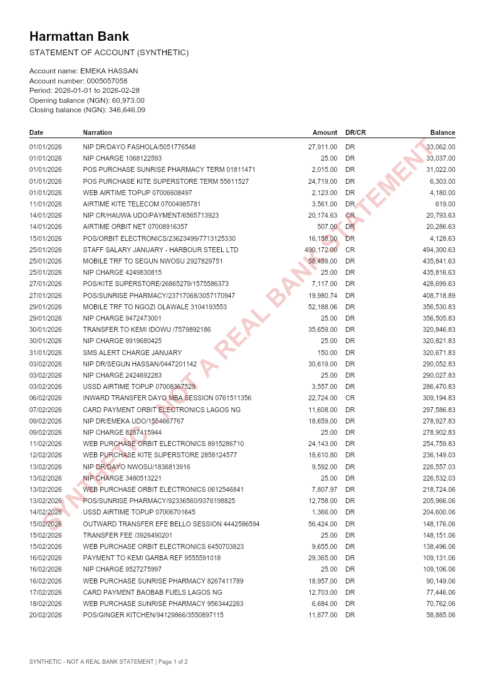

# @kobokit/statement-generator

[](https://www.npmjs.com/package/@kobokit/statement-generator)
[](https://github.com/Okoli-Ryan/kobokit/blob/main/LICENSE)

Realistic but clearly fake Nigerian-style bank statements, as a text PDF plus a JSON answer key, so statement parsers, fraud detectors and AI pipelines can be tested without anyone's real data.



## Contents

- [Why this exists](#why-this-exists)
- [Safety rules](#safety-rules-not-configurable)
- [Install](#install)
- [Quick start](#quick-start)
- [Scenarios](#scenarios)
- [API reference](#api-reference)
- [The JSON output](#the-json-output)
- [Personas](#personas)
- [Banks and layouts](#banks-and-layouts)
- [Tampered statements](#tampered-statements)
- [CLI reference](#cli-reference)
- [Determinism](#determinism)
- [Errors](#errors)
- [Known limits](#known-limits)
- [Development](#development)

## Why this exists

Lenders judge income and affordability from bank statements, but statements are personal data, so developers building parsers have nothing safe to share or test against. This package generates statements with the correct answer attached: every amount, running balance, category, page and line is known, and a "tampered" mode records exactly what was forged.

It is a test-data tool. It helps you measure whether your parser, detector or model works. It does not prove anything about how they behave on real customer data.

## Safety rules (not configurable)

- **Fictional banks only:** Harmattan Bank, Kola Digital, Ember Wallet and Savanna Trust are invented. No real bank name, logo or copied layout is used.
- **Watermark on every page:** a diagonal `SYNTHETIC - NOT A REAL BANK STATEMENT`, plus the same sentence in every footer. Tampered statements keep it.
- **PDF metadata:** Producer and Creator are `kobokit statement-generator (synthetic)`.
- **Obviously fake identities:** account numbers always start with `000`; names are random pairs from a made-up pool; narrations come from templates marked `origin: "invented"`.
- **No real data in, none out.** Fee amounts, phone numbers and similar details are invented and marked `TODO` in the source. They are not claims about any real bank or rule.

The API accepts a custom `BankProfile` object (see [`generateStatement`](#api-reference)). If you use that, name it with a fictional bank. The watermark, footer and metadata still apply, but the bank name is yours to choose responsibly.

## Install

Requires Node 22.19 or newer. Ships ESM and CommonJS, with types.

```bash
npm install --save-dev @kobokit/statement-generator
```

The same package provides a command-line tool, `kobokit-statements` (see the [CLI reference](#cli-reference)). Run it without installing:

```bash
npx @kobokit/statement-generator --help
```

## Quick start

### From code

```ts
import { writeFileSync } from 'node:fs';
import { generateStatement, renderPdf, toJson } from '@kobokit/statement-generator';

const { statement, bank } = generateStatement({
  seed: 'demo-1',
  persona: 'salaried',
  bank: 'harmattan',
  months: 3,
});

writeFileSync('statement.json', toJson(statement));
writeFileSync('statement.pdf', await renderPdf(statement, bank));
```

### From the command line

```bash
# one statement: writes a PDF and a JSON file
npx kobokit-statements generate --persona salaried --months 6 --bank harmattan --seed 42 --out ./out

# the same, with two forged amounts (balances left unfixed) and a later PDF modification date
npx kobokit-statements generate --persona salaried --months 6 --bank harmattan --seed 42 --out ./out \
  --tamper amount,date --tamper-count 2

# 40 statements across every persona and bank, a fifth of them tampered, with a manifest.json
npx kobokit-statements batch --count 40 --months 6 --seed eval-1 --tamper-ratio 0.2 --out ./dataset
```

## Scenarios

Each scenario is a real use. `yourParser` and `yourDetector` stand for the code you are testing.

### 1. Measure a statement parser against the answer key

You have a parser that turns a PDF into rows. Generate a statement, parse its PDF, and compare to the JSON.

```ts
import { generateStatement, renderPdf } from '@kobokit/statement-generator';

const { statement, bank } = generateStatement({
  seed: 'parser-1',
  persona: 'trader',
  bank: 'ember',
  months: 3,
});
const pdf = await renderPdf(statement, bank);

const parsed = await yourParser(pdf); // your code: [{ debit, credit, balance }, ...] in kobo

const exact = statement.transactions.filter((truth, i) => {
  const got = parsed[i];
  return got?.debit === truth.debit && got.credit === truth.credit && got.balance === truth.balance;
});
console.log(`${exact.length}/${statement.transactions.length} rows exact`);
```

Money is integer kobo (1 naira = 100 kobo), so compare with `===`, never with a tolerance.

### 2. Check a parser handles every layout

Statements generated from the same seed have the same transactions, balances and account holder whatever the bank, because only the layout changes. That makes layout the one variable. Only `page` and `line` can differ, since the grouped layout spends lines on date headings.

```ts
import { BANKS, generateStatement, renderPdf } from '@kobokit/statement-generator';

for (const profile of BANKS) {
  const { statement, bank } = generateStatement({
    seed: 'layouts',
    persona: 'salaried',
    bank: profile.id,
    months: 2,
  });
  const rows = await yourParser(await renderPdf(statement, bank));
  console.log(profile.id, profile.family, rows.length === statement.transactions.length);
}
```

### 3. Score a fraud detector

Forge a statement, then compare your detector's flagged rows to the recorded changes.

```ts
import { generateStatement, renderPdf, tamperStatement } from '@kobokit/statement-generator';

const { statement, bank } = generateStatement({
  seed: 'fraud-1',
  persona: 'salaried',
  bank: 'kola',
  months: 6,
});
const forged = tamperStatement(statement, 'fraud-1', { amounts: 2, modifiedAt: true });

const truth = new Set(forged.tampering?.amountChanges.map((c) => c.index));
const flagged = new Set(await yourDetector(await renderPdf(forged, bank))); // row indices

const hits = [...flagged].filter((i) => truth.has(i)).length;
console.log({ precision: hits / flagged.size, recall: hits / truth.size });
```

The untouched `statement` is your negative example: a detector that flags it has a false positive.

### 4. Build a labelled evaluation dataset

One command writes a reproducible dataset and a `manifest.json` that labels each file.

```bash
npx kobokit-statements batch --count 40 --months 6 --seed eval-1 --tamper-ratio 0.2 --out ./dataset
```

```ts
import { readFileSync } from 'node:fs';

const manifest = JSON.parse(readFileSync('./dataset/manifest.json', 'utf8'));
const forged = manifest.filter((entry) => entry.tampered);
console.log(`${forged.length} tampered, ${manifest.length - forged.length} clean`);
```

Every persona and bank combination appears before any repeats, so a batch of 20 covers all 5 x 4 pairs.

### 5. Evaluate an LLM or income-extraction pipeline

Work out the correct answer from the JSON, then compare it to what your pipeline says.

```ts
import { formatKobo, generateStatement, kobo } from '@kobokit/statement-generator';

const { statement } = generateStatement({
  seed: 'income-1',
  persona: 'salaried',
  bank: 'harmattan',
  months: 6,
});

const salaries = statement.transactions.filter((t) => t.category === 'salary');
const total = salaries.reduce((sum, t) => sum + t.credit, 0);
const monthlyIncome = kobo(Math.round(total / 6));

console.log(`True average monthly salary: NGN ${formatKobo(monthlyIncome)}`);
// compare with what yourPipeline(pdfText) reports
```

### 6. Test a persona of your own

Describe a customer segment as config. Money is integer kobo; use `naira()` to keep the numbers readable.

```ts
import { generateStatement, naira, parsePersona } from '@kobokit/statement-generator';

const nightMarket = parsePersona({
  id: 'night-market',
  label: 'Night-market seller',
  openingBalance: { min: naira(20_000), max: naira(80_000) },
  activities: [
    {
      category: 'transfer_in',
      perMonth: { min: 20, max: 30 },
      amount: { min: naira(3_000), max: naira(80_000) },
      probability: 0.9,
    },
    {
      category: 'pos',
      perMonth: { min: 10, max: 20 },
      amount: { min: naira(1_000), max: naira(15_000) },
      probability: 0.8,
    },
  ],
});

const { statement } = generateStatement({
  seed: 'nm-1',
  persona: nightMarket,
  bank: 'savanna',
  months: 3,
});
```

### 7. Check any statement for balance consistency

`verifyBalances` works on anything with an opening balance, a closing balance and rows. Use it on a parser's output to see whether it dropped or misread a row.

```ts
import { verifyBalances } from '@kobokit/statement-generator';

const check = verifyBalances({
  openingBalance: parsedOpening,
  closingBalance: parsedClosing,
  transactions: parsedRows, // each { debit, credit, balance } in kobo
});
if (!check.ok) console.log('inconsistent rows:', check.badRows, 'totals match:', check.totalsMatch);
```

### 8. Stable fixtures in your own tests

The same seed gives the same statement, so a test can assert exact numbers.

```ts
import { expect, it } from 'vitest';
import { generateStatement } from '@kobokit/statement-generator';

it('parses the demo statement', () => {
  const { statement } = generateStatement({
    seed: 'fixture-1',
    persona: 'gig-worker',
    bank: 'ember',
    months: 1,
  });
  expect(statement.transactions.length).toBeGreaterThan(0);
  // Pin the package version: output may change between versions (see Determinism).
});
```

## API reference

### Functions

| Export              | Signature                                                | What it does                                                                                                                                                                     |
| ------------------- | -------------------------------------------------------- | -------------------------------------------------------------------------------------------------------------------------------------------------------------------------------- |
| `generateStatement` | `(options: GenerateOptions) => GeneratedStatement`       | Builds a statement: transactions, balances, and each row's `page` and `line`. Returns `{ statement, bank }`. Pass `bank` on to `renderPdf` so the PDF uses the right date style. |
| `renderPdf`         | `(statement, bank, options?) => Promise<Uint8Array>`     | Draws the statement as a text PDF with watermark, footer and metadata. A tampered statement's modification date is applied automatically; `options.modifiedAt` overrides it.     |
| `tamperStatement`   | `(statement, seed, options: TamperOptions) => Statement` | Returns a forged copy: amounts changed without fixing balances and/or a later PDF modification date. The copy carries a `tampering` record. The input is not modified.           |
| `verifyBalances`    | `(statement) => BalanceCheck`                            | Checks every row against the previous row's stated balance, then the totals against the closing balance.                                                                         |
| `toJson`            | `(statement) => string`                                  | Two-space JSON with a trailing newline. Identical input gives identical text.                                                                                                    |
| `parsePersona`      | `(input: unknown) => Persona`                            | Validates a custom persona and fills defaults. Throws `TypeError` with every problem listed.                                                                                     |
| `getBuiltInPersona` | `(id: string) => Persona`                                | Looks up a built-in persona. Throws `RangeError` listing the valid ids.                                                                                                          |
| `getBank`           | `(id: string) => BankProfile`                            | Looks up a bank by id. Throws `RangeError` listing the valid ids.                                                                                                                |
| `kobo`              | `(value: number) => Kobo`                                | Brands a whole number as kobo. Throws `RangeError` for floats, `NaN` or unsafe integers.                                                                                         |
| `naira`             | `(wholeNaira: number) => Kobo`                           | Converts whole naira to kobo. `naira(1_500)` is `150000`.                                                                                                                        |
| `formatKobo`        | `(amount: Kobo) => string`                               | Formats with thousands separators and two decimals, using integer maths only: `123456789` becomes `"1,234,567.89"`.                                                              |

### Constants

| Export              | Value                                       | Notes                                                             |
| ------------------- | ------------------------------------------- | ----------------------------------------------------------------- |
| `BANKS`             | array of four `BankProfile`                 | The fictional banks. See [Banks and layouts](#banks-and-layouts). |
| `BUILT_IN_PERSONAS` | array of five `Persona`                     | See [Personas](#personas).                                        |
| `CATEGORIES`        | the twelve transaction categories           | See [Categories](#categories).                                    |
| `WATERMARK_TEXT`    | `"SYNTHETIC - NOT A REAL BANK STATEMENT"`   | Printed diagonally on every page and in the footer.               |
| `PDF_PRODUCER`      | `"kobokit statement-generator (synthetic)"` | Written to the PDF Producer and Creator fields.                   |
| `DEFAULT_START`     | `"2026-01-01"`                              | First day of a statement when `start` is not given.               |

### Types

| Type                 | Describes                                                                                     |
| -------------------- | --------------------------------------------------------------------------------------------- |
| `GenerateOptions`    | Input to `generateStatement` (below).                                                         |
| `GeneratedStatement` | `{ statement: Statement; bank: BankProfile }`.                                                |
| `Statement`          | The JSON shape: header fields, `transactions`, and optional `tampering`.                      |
| `Transaction`        | One row: `id`, `date`, `narration`, `debit`, `credit`, `balance`, `category`, `page`, `line`. |
| `TamperOptions`      | `{ amounts?: number; modifiedAt?: string \| true }`.                                          |
| `TamperRecord`       | `{ amountChanges: AmountChange[]; pdfModifiedAt?: string }`.                                  |
| `AmountChange`       | `{ id, index, page, line, field: 'debit' \| 'credit', original, tampered }`.                  |
| `BalanceCheck`       | `{ ok: boolean; badRows: number[]; totalsMatch: boolean }`.                                   |
| `RenderOptions`      | `{ modifiedAt?: string }`.                                                                    |
| `Persona`            | Validated persona config (output of `parsePersona`).                                          |
| `PersonaInput`       | What you may pass to `parsePersona` (defaults optional).                                      |
| `BankProfile`        | `{ id, name, family: FormatFamily, dateStyle }`.                                              |
| `FormatFamily`       | `'single-amount-drcr' \| 'debit-credit-columns' \| 'grouped-by-date'`.                        |
| `Category`           | One of the twelve category strings.                                                           |
| `Kobo`               | A `number` branded as integer kobo, so a plain float is rejected by the compiler.             |

### `GenerateOptions`

| Field     | Type                    | Required | Description                                                                                              |
| --------- | ----------------------- | -------- | -------------------------------------------------------------------------------------------------------- |
| `seed`    | `string \| number`      | yes      | Same seed and options give the same statement.                                                           |
| `persona` | `string \| Persona`     | yes      | A built-in id (`salaried`, `trader`, `gig-worker`, `bettor`, `loan-stacker`) or a custom persona object. |
| `bank`    | `string \| BankProfile` | yes      | A bank id (`harmattan`, `kola`, `ember`, `savanna`) or a custom profile.                                 |
| `months`  | `number`                | yes      | Whole number from 1 to 12.                                                                               |
| `start`   | `string`                | no       | First day, `YYYY-MM-DD`. Defaults to `2026-01-01`. The period ends the day before `start` plus `months`. |

### `TamperOptions`

| Field        | Type             | Description                                                                                                                     |
| ------------ | ---------------- | ------------------------------------------------------------------------------------------------------------------------------- |
| `amounts`    | `number`         | How many amounts to change. Each change leaves the running balances alone.                                                      |
| `modifiedAt` | `string \| true` | An ISO timestamp for the PDF modification date, or `true` to derive a later one from the seed. At least one option is required. |

## The JSON output

```jsonc
{
  "bank": "Harmattan Bank",
  "format": "single-amount-drcr",
  "persona": "salaried",
  "accountHolder": { "name": "EMEKA HASSAN", "accountNumber": "0005057058" },
  "period": { "from": "2026-01-01", "to": "2026-02-28" },
  "openingBalance": 6097300, // integer kobo, never floats
  "closingBalance": 34664609,
  "transactions": [
    {
      "id": "TX000001",
      "date": "2026-01-01",
      "narration": "NIP DR/DAYO FASHOLA/5051776548",
      "debit": 2791100, // 0 when the row is a credit
      "credit": 0,
      "balance": 3306200,
      "category": "transfer_out",
      "page": 1, // where it sits in the PDF
      "line": 1,
    },
  ],
}
```

This is shortened from a real file in the repository's `sample-output/` folder.

### Top-level fields

| Field            | Type                      | Meaning                                                        |
| ---------------- | ------------------------- | -------------------------------------------------------------- |
| `bank`           | string                    | Bank display name.                                             |
| `format`         | `FormatFamily`            | Which layout family the PDF uses.                              |
| `persona`        | string                    | Persona id.                                                    |
| `accountHolder`  | `{ name, accountNumber }` | Fictional holder. The account number always starts with `000`. |
| `period`         | `{ from, to }`            | ISO dates, inclusive.                                          |
| `openingBalance` | integer kobo              | Balance before the first transaction.                          |
| `closingBalance` | integer kobo              | Opening plus all credits minus all debits.                     |
| `transactions`   | `Transaction[]`           | In date order.                                                 |
| `tampering`      | `TamperRecord`            | Present only on tampered statements.                           |

### Transaction fields

| Field       | Type         | Meaning                                                                              |
| ----------- | ------------ | ------------------------------------------------------------------------------------ |
| `id`        | string       | `TX` plus a six-digit sequence number, unique within the statement.                  |
| `date`      | string       | ISO `YYYY-MM-DD`. The PDF shows it in the bank's own format.                         |
| `narration` | string       | The transaction description exactly as printed.                                      |
| `debit`     | integer kobo | Money out; `0` on a credit row.                                                      |
| `credit`    | integer kobo | Money in; `0` on a debit row.                                                        |
| `balance`   | integer kobo | Running balance after this row.                                                      |
| `category`  | `Category`   | The true category: the answer a narration parser should arrive at.                   |
| `page`      | integer      | 1-based page of the PDF the row is on.                                               |
| `line`      | integer      | 1-based body line on that page. In the grouped layout, date headings count as lines. |

### Categories

| Category            | Direction | Produced by                                                         |
| ------------------- | --------- | ------------------------------------------------------------------- |
| `salary`            | credit    | The persona's `salary` setting, on its set day each month.          |
| `transfer_in`       | credit    | A persona activity.                                                 |
| `transfer_out`      | debit     | A persona activity.                                                 |
| `pos`               | debit     | A persona activity.                                                 |
| `atm`               | debit     | A persona activity.                                                 |
| `airtime_data`      | debit     | A persona activity.                                                 |
| `bill`              | debit     | A persona activity.                                                 |
| `betting`           | debit     | A persona activity.                                                 |
| `loan_disbursement` | credit    | A persona activity.                                                 |
| `loan_repayment`    | debit     | A persona activity.                                                 |
| `bank_charge`       | debit     | The generator: an ATM fee, a transfer fee, and a monthly fee.       |
| `reversal`          | credit    | The generator: a refund of a failed POS, transfer or airtime debit. |

A category fixes its direction, so a persona cannot describe a debit salary.

### Guarantees on every generated statement

- `opening + sum(credits) - sum(debits) = closing`, and every row's balance equals the previous balance plus credit minus debit.
- No balance is ever negative. A debit that would overdraw the account is dropped, together with its fee and reversal. This is why a month can have fewer transactions than the persona's `perMonth` range suggests.
- Every row has money on exactly one side.
- Dates are in order and inside the period.

## Personas

A persona is typed config. Built-in personas:

| Id             | Models                      | Opening balance (NGN) | Salary                   | Behaviour                                                                  |
| -------------- | --------------------------- | --------------------- | ------------------------ | -------------------------------------------------------------------------- |
| `salaried`     | Salaried employee           | 40,000 to 300,000     | 25th, 250,000 to 600,000 | Steady spending: transfers, POS, ATM, airtime, a few bills.                |
| `trader`       | Market trader               | 20,000 to 500,000     | none                     | Many inflows of varying size, heavy POS and outward transfers.             |
| `gig-worker`   | Gig worker                  | 5,000 to 120,000      | none                     | Irregular inflows; each planned inflow only happens about 60% of the time. |
| `bettor`       | Frequent bettor             | 10,000 to 200,000     | 28th, 120,000 to 280,000 | Many betting debits each month.                                            |
| `loan-stacker` | Borrower with several loans | 3,000 to 80,000       | 26th, 150,000 to 350,000 | Several loan disbursements and more repayments, to different lenders.      |

All figures are invented to look plausible, not measured from real data.

### Persona fields

| Field                 | Type                              | Description                                                                   |
| --------------------- | --------------------------------- | ----------------------------------------------------------------------------- |
| `id`                  | string                            | Non-empty. Appears in the JSON and in file names.                             |
| `label`               | string                            | Non-empty human description.                                                  |
| `openingBalance`      | `{ min, max }`                    | Integer kobo, `min <= max`.                                                   |
| `salary`              | `{ dayOfMonth, amount }` optional | `dayOfMonth` is 1 to 28. One amount and one employer for the whole statement. |
| `activities`          | array                             | See below.                                                                    |
| `reversalProbability` | number 0 to 1, default `0.02`     | Chance that a POS, transfer or airtime debit is refunded the next day.        |

Each activity:

| Field         | Type           | Description                                                                                                            |
| ------------- | -------------- | ---------------------------------------------------------------------------------------------------------------------- |
| `category`    | one of nine    | `transfer_in`, `transfer_out`, `pos`, `atm`, `airtime_data`, `bill`, `betting`, `loan_disbursement`, `loan_repayment`. |
| `perMonth`    | `{ min, max }` | How many occurrences to plan each month (a plain count, not money).                                                    |
| `amount`      | `{ min, max }` | Integer kobo per occurrence.                                                                                           |
| `probability` | number 0 to 1  | Chance each planned occurrence really happens. Below 1 makes the pattern irregular.                                    |

Salary, bank charges and reversals are produced by the generator, so they cannot be listed as activities. A custom persona file for the CLI is the same object as JSON (amounts in kobo).

## Banks and layouts

| Id          | Name           | Layout (`format`)                                               | Date shown in the PDF |
| ----------- | -------------- | --------------------------------------------------------------- | --------------------- |
| `harmattan` | Harmattan Bank | `single-amount-drcr`: one amount column plus a `DR`/`CR` marker | `01/03/2026`          |
| `kola`      | Kola Digital   | `debit-credit-columns`: separate debit and credit columns       | `2026-03-01`          |
| `ember`     | Ember Wallet   | `grouped-by-date`: rows under a date heading                    | `01 Mar 2026`         |
| `savanna`   | Savanna Trust  | `debit-credit-columns`                                          | `01-Mar-2026`         |

The JSON always uses ISO dates. Layouts are our own designs for variety, not imitations of any real bank.

PDF details: A4, standard Helvetica (so every character is selectable text and amounts print without the naira sign), 42 body lines on page 1 and 48 on later pages. Text that is too wide shrinks to fit its column instead of being cut, so a narration is never truncated.

## Tampered statements

`tamperStatement` forges a finished statement the way a forger might.

- **Amounts (`amounts: n`)** changes `n` amounts and leaves every running balance and the closing balance untouched. Credits are inflated and debits shrunk, by 10 to 90 percent, on rows of at least NGN 100. Reconciliation then breaks on exactly the changed rows.
- **Date (`modifiedAt`)** sets the PDF modification date later than its creation date. Amounts still reconcile. An untampered PDF has the two dates equal.
- The watermark, footer and metadata stay.

The JSON gains a `tampering` record:

```jsonc
"tampering": {
  "amountChanges": [
    { "id": "TX000013", "index": 12, "page": 1, "line": 13,
      "field": "debit", "original": 711700, "tampered": 227744 },
    { "id": "TX000017", "index": 16, "page": 1, "line": 17,
      "field": "debit", "original": 3565900, "tampered": 677521 }
  ],
  "pdfModifiedAt": "2026-04-27T10:58:00.000Z"
}
```

`verifyBalances(forged).badRows` equals the `index` of each change. Rows are checked against the previous row's stated balance, so a forged amount flags only its own row, not every row after it. The separate `totalsMatch` flag catches whole-statement problems, such as a wrong closing balance.

A forger who also rewrote every later balance would produce a statement that reconciles. This tool does not generate that case.

## CLI reference

```
kobokit-statements generate --persona <id> --bank <id> --seed <text> --out <dir> [options]
kobokit-statements batch    --count <n> --seed <text> --out <dir> [options]
```

### `generate`

| Flag             | Required | Default      | Description                                                       |
| ---------------- | -------- | ------------ | ----------------------------------------------------------------- |
| `--persona`      | yes\*    |              | Built-in persona id.                                              |
| `--persona-file` | yes\*    |              | Path to a custom persona JSON file. \*One of the two is required. |
| `--bank`         | yes      |              | `harmattan`, `kola`, `ember` or `savanna`.                        |
| `--seed`         | yes      |              | Any text.                                                         |
| `--out`          | yes      |              | Output folder. Created if missing.                                |
| `--months`       | no       | `6`          | 1 to 12.                                                          |
| `--start`        | no       | `2026-01-01` | First day, `YYYY-MM-DD`.                                          |
| `--tamper`       | no       |              | `amount`, `date` or `amount,date`.                                |
| `--tamper-count` | no       | `1`          | How many amounts to change when `--tamper` includes `amount`.     |

### `batch`

| Flag             | Required | Default      | Description                                                                            |
| ---------------- | -------- | ------------ | -------------------------------------------------------------------------------------- |
| `--count`        | no       | `20`         | How many statements.                                                                   |
| `--seed`         | yes      |              | Each statement gets seed `<seed>-<n>`.                                                 |
| `--out`          | yes      |              | Output folder.                                                                         |
| `--months`       | no       | `6`          | 1 to 12.                                                                               |
| `--start`        | no       | `2026-01-01` | First day.                                                                             |
| `--tamper-ratio` | no       | `0`          | Share from 0 to 1 that get tampered, chosen from the seed. The kind of forgery varies. |

### Output files

- `generate` writes `<bank>_<persona>_<seed>_<months>m[_tampered].json` and `.pdf`.
- `batch` writes the same pair for each statement, plus `manifest.json`: an array of `{ file, persona, bank, seed, months, tampered }`.

### Exit codes

| Code | Meaning                                                                                  |
| ---- | ---------------------------------------------------------------------------------------- |
| `0`  | Success.                                                                                 |
| `1`  | A runtime failure, such as an unknown bank or an unreadable persona file.                |
| `2`  | Bad arguments, for example a missing flag. The message ends with a hint to run `--help`. |

## Determinism

The same package version, the same options and the same seed always give byte-identical JSON. Nothing reads the clock or the machine's timezone, and randomness is seeded.

What can change the output:

- **A different option or seed**, by design.
- **A different package version.** Narration templates, fees and the planner are part of the output, so a minor release can change what a seed produces. Pin the version if your tests assert exact values.

PDFs are deterministic too: the creation date is derived from the statement's period, never from the current time.

## Errors

| Call                                | Throws       | When                                                                                                                                                                          |
| ----------------------------------- | ------------ | ----------------------------------------------------------------------------------------------------------------------------------------------------------------------------- |
| `generateStatement`                 | `RangeError` | `months` is not a whole number from 1 to 12; unknown persona or bank id; `start` is not a real date.                                                                          |
| `generateStatement`, `parsePersona` | `TypeError`  | A custom persona fails validation (inverted range, float kobo, probability above 1, a salary day above 28, a category a persona may not use). The message lists each problem. |
| `tamperStatement`                   | `RangeError` | Neither `amounts` nor `modifiedAt` given; fewer than `amounts` rows are large enough; `modifiedAt` is not a valid timestamp.                                                  |
| `renderPdf`                         | `RangeError` | `options.modifiedAt` is not a valid timestamp.                                                                                                                                |
| `kobo`, `naira`                     | `RangeError` | The result is not a safe integer.                                                                                                                                             |

## Known limits

- Output is text-based PDF only. There are no scanned or photographed variants, so a parser that needs OCR must be tested another way.
- Only standard Helvetica is used, so amounts print without the naira sign and headings say `NGN`.
- Fee amounts, charge names and phone-number formats are invented. TODO: replace with sourced, redacted real patterns before treating any of it as representative.
- Layouts and narrations are our own designs. A parser that scores well here may still struggle with the messiness of real statements.
- Tampering changes amounts and dates only. It does not forge a fully consistent statement.
- Statements run 1 to 12 months, as a single account in naira.

## Development

```bash
pnpm --filter @kobokit/statement-generator test    # unit, property (fast-check), round-trip and tamper tests
pnpm --filter @kobokit/statement-generator build
pnpm --filter @kobokit/statement-generator samples # rebuild sample-output/ (run build first)
```

The repository's `sample-output/` folder holds one statement per bank (PDF and JSON, seed `sample`, two months) and one tampered example. A test fails if those files drift from what the generator produces.

The tests cover: balances reconcile for any seed and persona; the same seed gives identical JSON; every amount, balance and narration is found by `pdfjs` on the page the JSON states; the watermark and footer are on every page; metadata is set; and tampering breaks reconciliation exactly where the JSON says.

Part of the [kobokit](https://github.com/Okoli-Ryan/kobokit) monorepo. Design decisions are in its `docs/DECISIONS.md`.

## License

MIT
